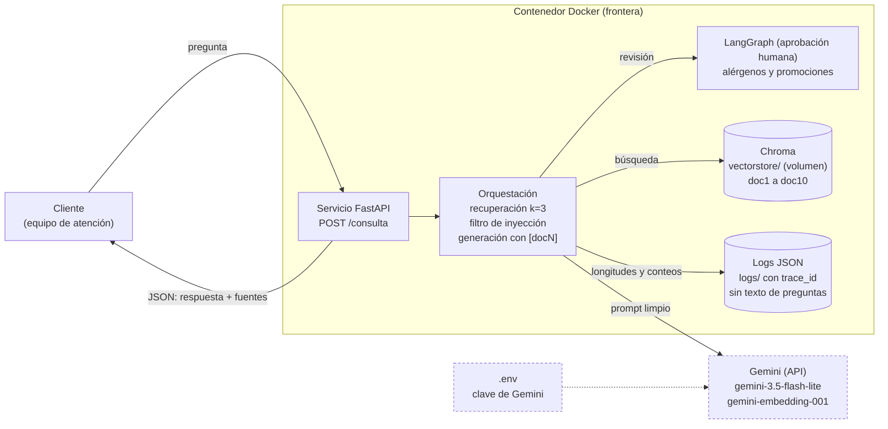

# Diagrama de arquitectura: asistente de atención al cliente de la Chocolatería (Bloque 34)

Versión en Mermaid de `diagrama_arquitectura_01.png`. Los rótulos de las cajas son los mismos que se usan en la sección 3 de `ficha_diseno_funcional_04.md`.

## Componentes

| Caja | Función |
| --- | --- |
| Cliente | Integrante del equipo de atención que envía la pregunta y recibe la respuesta en JSON. |
| Servicio FastAPI | Expone el endpoint POST /consulta (RF-01). |
| Orquestación | Recupera 3 documentos, descarta los que traen inyección (RF-04) y genera la respuesta con citas [docN] (RF-02). |
| LangGraph (aprobación humana) | Retiene las respuestas sobre alérgenos o promociones sin respaldo hasta que una persona las apruebe o rechace (RF-05). |
| Chroma | Vector store persistido en vectorstore/, montado como volumen del contenedor. |
| Logs JSON | Registro con trace_id en logs/, solo con longitudes, huellas y conteos (RNF-02). |
| Gemini (API) | Modelo externo, fuera del contenedor. La clave se lee desde .env. |
| Contenedor Docker (frontera) | Empaqueta el servicio para que levante siguiendo el README (RNF-03). |
